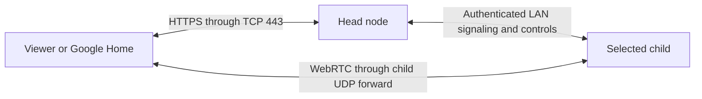

# Multiple camera deployment plan

Status: planned, not implemented. Agreed design as of 2026-10-19.

Run the same firmware on cameras in `standalone`, `head`, or `child` mode.
One head receives the public HTTPS connection and handles authentication,
Google Home fulfillment, camera selection, and signaling. Each selected camera
sends encrypted WebRTC media directly to the viewer through its own UDP port.
The head can also stream its own camera.

## Agreed scope

- Configure one UDP port per node in its local configuration. Use the same port
  for the local socket and public forwarding; separate internal and external
  port settings are unnecessary for this version.
- Discover children automatically, pair them once through the head's web UI,
  and reconnect automatically after reboot. Provide manual registration by IP
  when discovery is unavailable.
- Support WebRTC-only remote child playback. Do not proxy child HLS or MP4
  through the head or advertise those protocols for children in Google Home.
- Preserve existing standalone behavior and the head's own playback options.
- Configure router forwarding manually. Automatic router configuration, TURN
  relaying, and automatic head failover are outside the first version.

## Network layout

The following addresses are examples. Reserve each camera's LAN address in DHCP
so forwarding rules remain valid.

| Public router port | LAN destination | Purpose |
| --- | --- | --- |
| TCP 443 | Head `192.168.1.100:8443` | Website, OAuth, Google fulfillment, signaling |
| UDP 50000 | Head `192.168.1.100:50000` | Head camera media |
| UDP 50001 | Child A `192.168.1.101:50001` | Child A media |
| UDP 50002 | Child B `192.168.1.102:50002` | Child B media |

Each node uses one UDP socket for its concurrent WebRTC viewers. The existing
session demultiplexing separates viewers; a new port per viewer is unnecessary.
The head rejects duplicate configured UDP ports in its registry because each
public port must identify one camera behind the shared public address.

Forwarding TCP 443 alone does not make child media reachable. Each child needs
its own UDP forward. Registration must display the required rule and distinguish
LAN reachability from verified remote playback.

## Node configuration and responsibilities

Proposed configuration fields include a node role, a persistent unique node ID,
a display name, and `webrtc.udpPort`. These are design names, not settings accepted
by the current configuration tools. Default the UDP port to 50000 for existing
standalone installations. Generate a unique identity per installation rather
than embedding one shared identity or pairing secret in the firmware image.

The child owns capture, encoding, WebRTC sessions, ICE credentials, its DTLS
certificate, media encryption, recording, and physical camera controls.
Starting WebRTC must not depend on Google OAuth being enabled on that node.

The head owns the camera registry, public HTTPS certificate, Google account
linking, public DNS updates, and routing of authorized requests. Children do not
need copies of Google OAuth credentials or public certificate renewal jobs.
The head supplies current public-address information to children for new
sessions; already-negotiated session descriptions remain stable. A WAN address
change may require reconnecting active viewers.

## Discovery and registration

Use mDNS/DNS-SD for discovery on the local network. Advertise a stable node ID
and API version, without pairing secrets. mDNS is link-local multicast, so
discovery may not cross VLANs or networks that filter multicast.
See the [mDNS specification](https://www.rfc-editor.org/info/rfc6762/).

1. A child appears as unpaired on the head's **Cameras** page.
2. The owner selects **Add**, verifies a pairing code or setup credential, and
   chooses a display name. Provision the credential during installation and
   expose it through the child's authenticated local setup page.
3. Pairing establishes authenticated trust between the head and child. Use
   pinned TLS for subsequent LAN API requests; finalize the pairing exchange
   before implementation so discovery alone cannot authorize enrollment.
4. The head saves the node ID, name, LAN endpoint, UDP port, API version, and
   per-child trust material. The child persists its head association.
5. Authenticated heartbeats update availability and addresses. Reboots and
   rediscovery reuse the same identity rather than adding duplicate cameras.

Provide **Add by IP** using the same pairing checks. The UI should also support
rename, remove/unpair, and online/offline status. Removing a node revokes its
pairing and stream authorization. A changed UDP port must flag that the router
rule needs updating. Persist the registry and pairing material privately.

Discovery and registration do not configure Wi-Fi or router port forwarding.
Children must already be connected to the LAN. Address discovery after DHCP
changes does not repair a router rule that still targets the old address.

## Stream and control flow

1. Google requests a registered device ID, or an authenticated website viewer
   selects a camera.
2. The head checks that node's availability and asks it to reserve a session.
3. The head returns its own HTTPS signaling URL and an expiring token bound to
   the selected node and session.
4. The viewer's SDP offer passes through the head to that child.
5. The child returns an SDP answer containing its own ICE credentials, DTLS
   fingerprint, and LAN/public candidates. For Child A, these are
   `192.168.1.101:50001` and `<public-IP>:50001`.
6. The head forwards the answer. ICE selects a reachable candidate and media
   flows directly between the child and viewer. Forward session-end requests
   to the same child and reclaim abandoned reservations on timeout.

The head must preserve the child's transport credentials and fingerprint.
Changing the port in the head's own SDP would not establish a child session.
Google separates the signaling endpoint from SDP negotiation and requires
complete candidates without trickle ICE; see its
[CameraStream requirements](https://developers.home.google.com/cloud-to-cloud/traits/camerastream#webrtc-protocol-specifications).

Use stable node IDs in Google SYNC and route QUERY, EXECUTE, recording, and
movement commands to the selected camera. Preserve the existing device ID
for the original camera when upgrading. Report per-node availability and
capabilities, and retain existing H.264 and negotiated silent-audio behavior.

Keep remote-session bookkeeping separate from the head's local media slots.
Each child enforces its own media capacity. Bound registry size, pending
requests, and response sizes to fit camera memory. LAN requests need short
timeouts and nonblocking or otherwise isolated handling so one offline child
does not stall the head's capture or other requests.

Reject unknown IDs, mismatched node/session tokens, and expired or retired
sessions. Retries should reuse valid reservations instead of leaking slots.
A child restart invalidates its old sessions. A head outage prevents new
remote signaling; established direct media may continue until normal session
expiry, but reconnection requires the head.

## Network limitations and fallback policy

Direct UDP depends on both the camera's public reachability and the viewer's
network policy. Do not assume a universal failure rate.

| Network condition | Consequence |
| --- | --- |
| Viewer firewall or VPN blocks outbound UDP or requires a web proxy | HTTPS signaling can succeed while direct media fails |
| Restrictive corporate, school, or hotel Wi-Fi | May block UDP; behavior depends on policy |
| Camera ISP uses CGNAT | Home-router forwarding alone cannot expose the camera |
| Camera is behind two NAT routers | Both need forwarding, or one must use bridge mode |
| Guest Wi-Fi isolation or separating VLAN firewall | May prevent discovery, head-to-child access, or local playback |

CGNAT at the camera site can also block the head's incoming HTTPS connection.
HLS fallback alone would not solve that deployment problem. Conversely, a
viewer behind mobile-carrier NAT can still initiate UDP to a publicly reachable
camera; carrier NAT on the viewer side is not by itself a reason to reject
this design. See [CGNAT limitations](https://www.rfc-editor.org/rfc/rfc6598.html).

The existing project has demonstrated Google Home playback over mobile data,
but that does not establish compatibility with every network. Validate the
intended home, mobile, and remote Wi-Fi networks. Child playback should show a
clear connection failure when direct UDP is unavailable, with no HLS/MP4 fallback.

If restrictive networks become a requirement, evaluate TURN over TCP/TLS as a
separate feature requiring relay infrastructure and integration work. It is a
standard approach to restrictive firewalls, not part of the current sender.
See [WebRTC transports](https://www.rfc-editor.org/rfc/rfc8835.html).

## Implementation sequence

1. Add runtime UDP-port configuration and validation in the configuration tools
   and firmware. Update socket binding and both SDP offer and answer generation
   in `camera/src/webrtc.c` and `camera/src/webrtc-sdp.h`. Preserve port 50000
   defaults and separate WebRTC initialization from `google_init`.
2. Add roles, persistent node identities, the child API, authenticated pairing,
   registry storage, discovery, and the head's registration UI. Include manual
   registration and explicit router-forward instructions.
3. Route website signaling through the head to one child, then multiple
   children. Verify direct media before adding Google device routing.
4. Replace single-device assumptions in `camera/src/google.c` and
   `camera/src/google-fulfillment.inc`; route Google discovery, streaming,
   status, and controls per node. Advertise only WebRTC for children.
5. Document deployment and validate on real cameras and Google receivers.

## Acceptance checks

- Existing standalone configuration and playback continue to work.
- Configured UDP ports appear correctly in binding and LAN/public candidates;
  invalid ports and duplicate registered ports are rejected.
- Automatic discovery and manual registration both require pairing; reboot
  restores associations without duplicate devices.
- The head and multiple children stream simultaneously on LAN and mobile data;
  packet capture or network counters confirm child media bypasses the head.
- Google device selection, recording, and movement affect only the requested
  camera. Child responses advertise no HLS/MP4 fallback.
- Wrong-camera tokens, stale sessions, failed pairing, and removed-node
  credentials are rejected; retries and timeouts do not leak capacity.
- Child disconnects, child/head restarts, full session capacity, and a changed
  public IP produce bounded failures and recover through a fresh connection.
- Blocking child UDP yields a clear playback error while the head remains
  responsive. Verify remote forwarding from outside the LAN; local success
  alone does not prove internet reachability.
